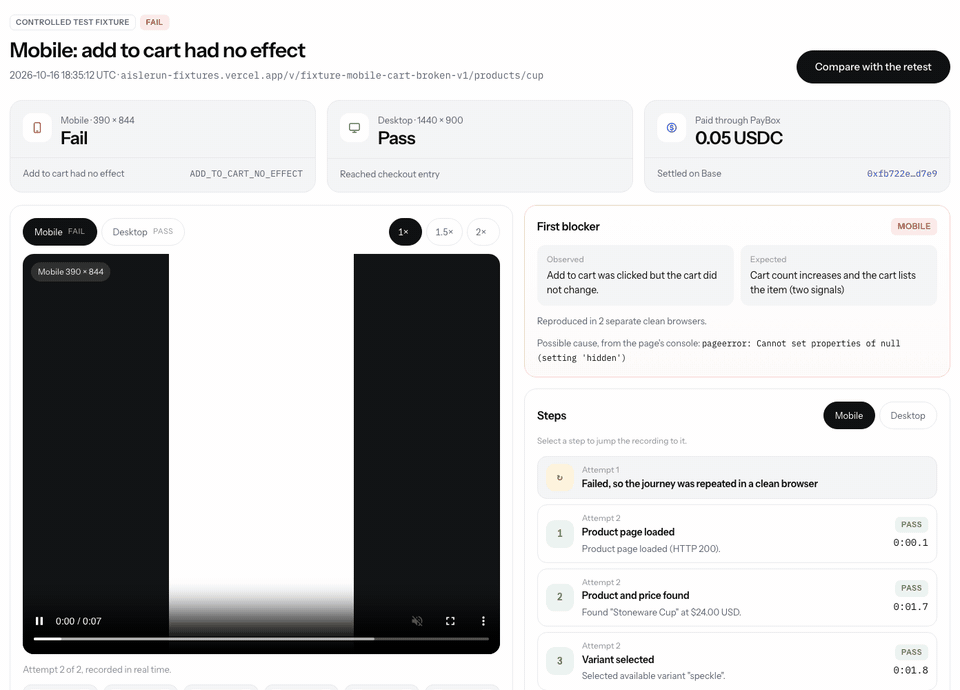

# AisleRun

An AI agent can pay to test whether customers can actually complete a store's buying journey.

An online store can load perfectly while the button that matters is broken. On a phone, Add to cart does nothing; on a laptop it works. Nothing crashes, no alert fires, and the merchant finds out when the sales stop. AisleRun runs a real browser through the purchase path on a phone and a desktop, records what happened, and hands back the evidence: a verdict per screen, the recording, and the first step that broke.



*Screen capture of the live report for paid run `2c076b7f`: the real Playwright recording of mobile attempt 2, beside the verdict the product produced. The store is AisleRun's own labelled test store, with a defect seeded on purpose.*

**See the failure and the paid retest side by side: https://aislerun.vercel.app/demo/compare**

**Demo video (2 min 15 s): https://x.com/winsznx/status/2111583612470497584**

## What the merchant experiences

1. The merchant asks their AI agent to check that shoppers can buy a product on their store.
2. The agent asks AisleRun for a price. It gets a quote back: 0.05 USDC for one inspection, what it covers, and a 15-minute expiry.
3. The agent pays from the merchant's PayBox wallet. PayBox enforces the limits the merchant set and handles the payment; AisleRun never sees a key.
4. Once the payment lands, a real Chromium browser opens the product page on a 390 × 844 phone and a 1440 × 900 desktop, adds the item to the cart, checks the cart really changed, and opens checkout. It never submits an order.
5. The agent gets a report: pass, fail or inconclusive per screen, the recording, screenshots, a Playwright trace, and the step that broke. A person can open the same report in the browser.
6. After a fix, the agent pays for a second inspection, and the two runs can be compared side by side.

## What actually happened

Every row below is a real inspection, paid through PayBox with USDC on Base on 16 Oct 2026, on AisleRun's own controlled test store. These are five runs on four known store versions, not a measurement of how well AisleRun catches bugs on real stores.

| Run | Store version | Mobile | Desktop | Payment verified to settled | Settled to finished | Settlement |
|---|---|---|---|---|---|---|
| `2c076b7f` | broken (seeded mobile defect) | **Fail**, `ADD_TO_CART_NO_EFFECT`, reproduced in 2 clean browsers | Pass | 0.90 s | 18.5 s | [0xfb722e65…](https://basescan.org/tx/0xfb722e65302dc65afee313efbfa158a9af72e0ca51ea707e091d17bc3cc8d7e9) |
| `f3f13c4c` | fixed (one-line repair), separate paid run | Pass | Pass | 0.87 s | 6.8 s | [0x0c9d639b…](https://basescan.org/tx/0x0c9d639b2864fae449f42520e26c8c9ff8cc4d9bdcc47e7992fa40c16bda0757) |
| `a06faa99` | healthy control | Pass | Pass | 1.06 s | 7.4 s | [0x1423cda7…](https://basescan.org/tx/0x1423cda7cf560ec6cbad24bce13150e36ff503ec5b33ceeb0fbd34233b35b7fa) |
| `aaebdec9` | bot-check wall | **Inconclusive**, `BROWSER_BLOCKED` | **Inconclusive**, `BROWSER_BLOCKED` | 0.48 s | 1.7 s | [0x4229a68b…](https://basescan.org/tx/0x4229a68b5c2d82ff9e9c87c9cb96f92f63b8c39c16109ae1692dd72dfec30f2e) |
| `fad7f747` | broken, re-run after moving servers (private report) | **Fail**, `ADD_TO_CART_NO_EFFECT` | Pass | 0.47 s | 19.4 s | [0x78b3576c…](https://basescan.org/tx/0x78b3576ceddee01e061fc7474d7c790adbbe2ab1d84a55601b30bbfa18aa3623) |

Three kinds of outcome are kept apart:

- **Fail** means AisleRun saw the store break. A cart that doesn't change is retried once in a fresh browser and only reported if it fails again.
- **Inconclusive** means the journey couldn't be judged, for example a bot check. The bot-check run above is not counted as a store failure.
- **Service error** (`FAILED_INTERNAL`, `CANCELLED`) means AisleRun itself failed. It never produces a store verdict. None of the five paid runs hit one; the behaviour is covered by tests.

The fix between `2c076b7f` and `f3f13c4c` is one line in [apps/fixtures/src/fixtures.ts](apps/fixtures/src/fixtures.ts): on narrow screens the cart looked for a drawer that doesn't exist. Each run's report has its recording, screenshots, steps and console output: [published runs](https://aislerun.vercel.app/demo). More evidence, including the raw PayBox traces, is in [docs/EVIDENCE_INDEX.md](docs/EVIDENCE_INDEX.md).

## How PayBox is used

There is no checkout page and no account. The buyer is the agent, and every step it needs is an HTTP request it can make on its own.

| Step | What happens | Code |
|---|---|---|
| Quote | Free `POST /v1/quotes`. Unauthorized stores are refused here, before any payment is asked for | [apps/api/src/app.ts](apps/api/src/app.ts) |
| Payment challenge | `POST /v1/inspections` answers HTTP 402 with an x402 v2 `PAYMENT-REQUIRED` header: 50000 atomic USDC on Base (`eip155:8453`) | [apps/api/src/payments.ts](apps/api/src/payments.ts), [apps/api/src/app.ts](apps/api/src/app.ts) |
| PayBox pays | The agent calls PayBox's `use_service` with the URL, `method: "POST"` and the quote body. PayBox reads the 402, signs a USDC transfer from the merchant's wallet and retries | [scripts/paybox-inspect.sh](scripts/paybox-inspect.sh) |
| Settle, then run | The job is created as `AWAITING_SETTLEMENT` and only joins the queue when the payment settles on Base. The browser never starts on an unsettled payment | [apps/api/src/app.ts](apps/api/src/app.ts) (`onAfterSettle`), [apps/worker/src/worker.ts](apps/worker/src/worker.ts) |
| Job details in the body | PayBox hands the response body, not headers, back to the agent, so the run ID, read token and report link are all in the body | [apps/api/src/app.ts](apps/api/src/app.ts) (`acceptedEnvelope`) |
| Safe retries | Re-sending the same quote and idempotency key returns the original run with no second charge. Two payments for one quote can't both settle | [apps/api/src/payment-identity.ts](apps/api/src/payment-identity.ts), [db/migrations/001_init.sql](db/migrations/001_init.sql) |

What has and hasn't been verified with PayBox:

- **Completed:** five paid inspections and one paid test call, all through the PayBox CLI's `use-service`, which calls the same server-side `use_service` tool an agent uses. Raw traces: [docs/evidence/paybox/](docs/evidence/paybox/).
- **Not completed:** a raw MCP client calling `use_service` on PayBox's MCP server reached `pending_signature` and stopped at PayBox's signing window, which only a chat host such as claude.ai or ChatGPT can display. Nothing was charged. A payment completed from a chat app has not been done. Details: [docs/INTEGRATION_FINDINGS.md](docs/INTEGRATION_FINDINGS.md).
- **Not confirmed:** AisleRun is not listed in the PayBox marketplace and doesn't appear in `discover_services`, which only lists services with at least 10 payers. Any PayBox agent can reach it by URL.

## PayBox plugin

[plugin/](plugin/) is the PayBox marketplace plugin, built from MoonPay's plugin starter 1.0.2. Its bundle, `plugin/dist/plugin.mjs`, is what gets uploaded to the developer portal. It has three tools:

| Tool | What it does | Cost |
|---|---|---|
| `list_test_stores` | The authorized test stores, the price and the network, from `/v1/meta` | free |
| `order_inspection` | Gets a quote, then returns an x402 payment proposal for `POST /v1/inspections`. PayBox checks the live 402, asks the user to approve 0.05 USDC on Base, pays and returns the run ID and read token | 0.05 USDC once approved |
| `get_inspection_result` | Status, verdicts per screen, the settlement transaction and the report link, read with the run's token | free |

The only network host it needs is `aislerun.158-220-85-120.sslip.io`. It needs no secrets or environment variables. `cd plugin && pnpm install --frozen-lockfile && pnpm test` type-checks, builds twice to confirm the bytes match, and runs MoonPay's conformance check. All three tools passed it locally against production on 17 Oct 2026; the hosted checks run in the portal after upload.

## Run it locally

You need Node 22+, Docker, and network access (the tests reach the public test store and the x402 facilitator). Nothing below spends money.

```bash
npm ci && npx playwright install chromium
cp .env.example .env        # then set POSTGRES_PASSWORD (also inside DATABASE_URL), REPORT_TOKEN_SECRET, PAYMENT_RECEIVER
docker compose up -d        # Postgres on 127.0.0.1:55432
npm test                    # 75 tests: unit, real Postgres, real x402 facilitator, real Chromium
npm start                   # API and browser worker on http://localhost:8790, migrations run on boot
```

`npm test` reads `.env`, then creates and drops its own throwaway databases. Without a `DATABASE_URL`, 54 tests run and the 21 database and browser tests are skipped. The web app is a separate Next.js project: `cd apps/site && npm ci && npm test && npm run dev` (docs tests, then the site on port 3100 against the live API, or set `NEXT_PUBLIC_API_URL=http://localhost:8790`).

**Paid runs cost real money.** [scripts/paybox-inspect.sh](scripts/paybox-inspect.sh) quotes, pays 0.05 USDC through your own PayBox wallet and polls the result. It needs a PayBox account (`npx paybox login`, then `npx paybox connect`), a wallet credential with USDC on Base, and an API that PayBox can reach over public HTTPS:

```bash
scripts/paybox-inspect.sh https://aislerun.158-220-85-120.sslip.io <your-credential-id> fixture-fixed-v2
```

## Tests

75 backend tests and 19 docs tests pass, along with both typechecks and the web app build (last run 17 Oct 2026). The integration tests use real PostgreSQL, the real PayAI x402 facilitator and real Chromium against the deployed test store. The ones that matter most:

| Behaviour | Test |
|---|---|
| A request without payment gets an x402 v2 challenge and creates no job | [tests/api.integration.test.ts](tests/api.integration.test.ts) |
| A correctly signed payment from an unfunded wallet is rejected and never creates a job | [tests/api.integration.test.ts](tests/api.integration.test.ts) |
| Retrying the same paid request returns the original job; a different key conflicts | [tests/api.integration.test.ts](tests/api.integration.test.ts) |
| The worker never starts a job whose payment hasn't settled | [tests/worker.integration.test.ts](tests/worker.integration.test.ts) |
| Real Chromium classifies the four store versions as Pass, Fail, Pass and Inconclusive | [tests/worker.integration.test.ts](tests/worker.integration.test.ts) |
| A crashed run is retried once on the same payment, then closed as a service error with no store verdict | [tests/worker.integration.test.ts](tests/worker.integration.test.ts) |
| A retest can only be compared with an older run of the same product | [tests/report.test.ts](tests/report.test.ts) |
| Reports need their own read token; evidence links fail when expired, tampered with or moved to another run | [tests/api.integration.test.ts](tests/api.integration.test.ts), [tests/tokens.test.ts](tests/tokens.test.ts) |
| Private, IP-literal and cross-store URLs are refused | [tests/targets.test.ts](tests/targets.test.ts) |

These are tests of AisleRun's own behaviour on known inputs. They don't show how reliably it detects bugs on other stores.

## How it's built

PayBox pays → the x402 service ([apps/api](apps/api)) verifies and settles the payment → the job joins a Postgres queue → the browser worker ([apps/worker](apps/worker)) leases it and runs the journey in Chromium ([packages/inspection/src/journey.ts](packages/inspection/src/journey.ts)) → recordings, screenshots and traces go to private storage with their SHA-256 → the report ([apps/api/src/report.ts](apps/api/src/report.ts)) is served to the agent as JSON and to people through the web app ([apps/site](apps/site)).

- The verdict comes from a fixed script and fixed rules. No language model writes or changes it.
- The browser can only reach the authorized store. Every request is checked, and in production the container's only route out drops private and cloud-metadata addresses.
- The test store is a separate static site, [apps/fixtures](apps/fixtures), deployed at https://aislerun-fixtures.vercel.app. It is not part of the product.
- Production: the web app on Vercel; the API, worker, Chromium and Postgres as one Docker stack on a shared server ([infra/vps](infra/vps)).

## Limitations

- The journey stops at the checkout entrance. Payment, shipping and order placement are never tested.
- It only works with stores whose product page, cart and checkout controls it recognises. Only one journey type exists, and many checkout patterns aren't supported.
- Bot protection can stop a run from reaching a verdict. That comes back as Inconclusive.
- Only AisleRun's own test store is authorized. No real merchant store has been tested, and there is no ownership check for adding one yet.
- Chromium only. A pass means the journey worked once on two screen sizes, not that every buyer can check out.
- Listing in the PayBox marketplace is unconfirmed.
- Completing a payment through PayBox's MCP connector in a chat app is unverified.
- Refunds for runs that fail on AisleRun's side are manual.

## Links

- Demo video: https://x.com/winsznx/status/2111583612470497584
- Product: https://aislerun.vercel.app
- Published runs: https://aislerun.vercel.app/demo
- Before and after: https://aislerun.vercel.app/demo/compare
- Docs: https://aislerun.vercel.app/docs
- API: https://aislerun.158-220-85-120.sslip.io/v1/meta

## Credits

The docs engine in [apps/site/lib/docs](apps/site/lib/docs) and [apps/site/components/docs](apps/site/components/docs) is adapted from Floatless under the MIT License; see [apps/site/lib/docs/LICENSE-floatless](apps/site/lib/docs/LICENSE-floatless).
